# TPS: This is my Treasure - Switch
We had 5 weeks at Isart Digital to create a game according to an imposed Game Design Document. This game can run on an imposed platform (Switch).
## More information:
This game uses the 5.4.4 version of [Unreal Engine](https://www.unrealengine.com/en-US) and has been optimized to run on Nintendo Switch.

<u>Documentation used:</u>
- [Unreal Engine 5.4 documentation](https://dev.epicgames.com/documentation/en-us/unreal-engine/unreal-engine-5-4-documentation?application_version=5.4)

<u>Assets used:</u>
- [Pirate/Parrot models and animations](https://poly.pizza/u/Quaternius)
- [Skeletons models and animations](https://poly.pizza/u/Kay%20Lousberg)
- [Environment](https://www.fab.com/listings/1fbd637d-f56e-4ca1-8bdb-82c7183bb530)
- [Fonts](https://www.dafont.com/fr/)
- [Sounds](https://freesound.org/)

## Controls:
### Keyboard (Debug) controls:
|    Controls   |     Action    |
|     :---:     |     :---:     |
| W - A - S - D |     Move      |
|     Mouse     |      Aim      |
|  Left click   |     Shoot     |
|     1 - 2     |  Select trap  |
|      A        | Validate Trap |
|      E        |  Rotate Trap  |
|      T        |  Change Mode  |
|   Numpad 0    |     Pause     |

### Gamepad controls:
|    Controls   |     Action    |
|     :---:     |     :---:     |
|  Left Stick   |     Move      |
|  Right Stick  |      Aim      |
|      R1       |     Shoot     |
|Direction Pad  |  Select trap  |
|      A        | Validate Trap |
|      B        |  Rotate Trap  |
|      Y        |  Change Mode  |
| Minus Button  |     Pause     |

## Screenshots:
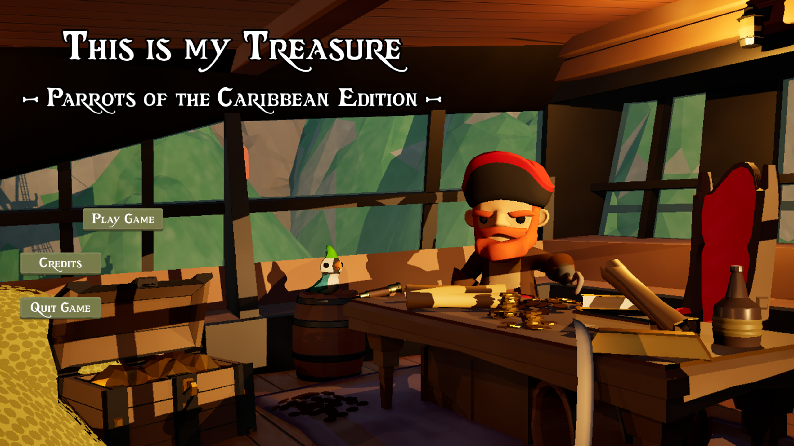
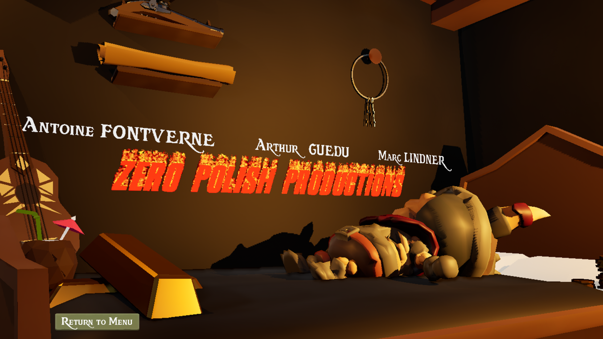
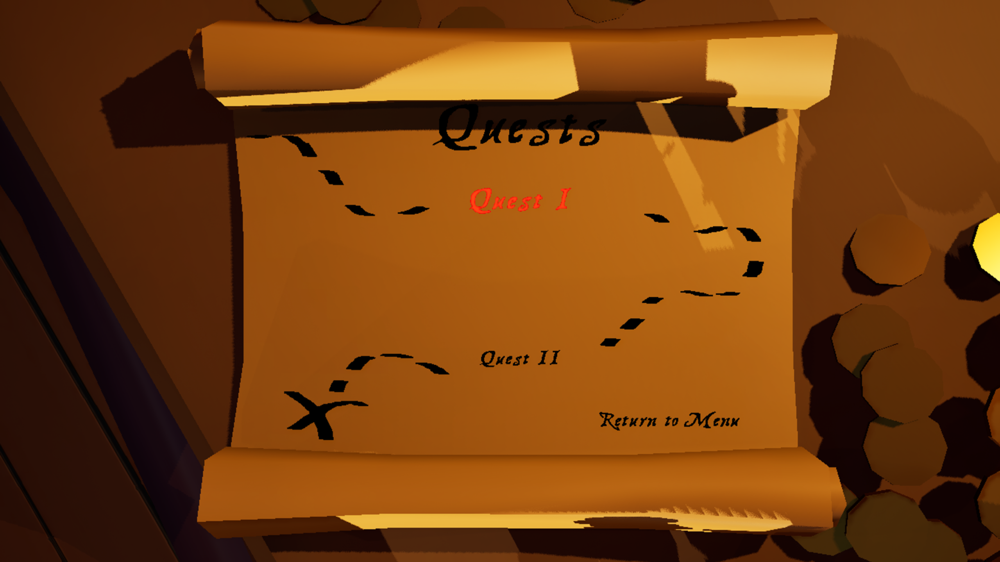
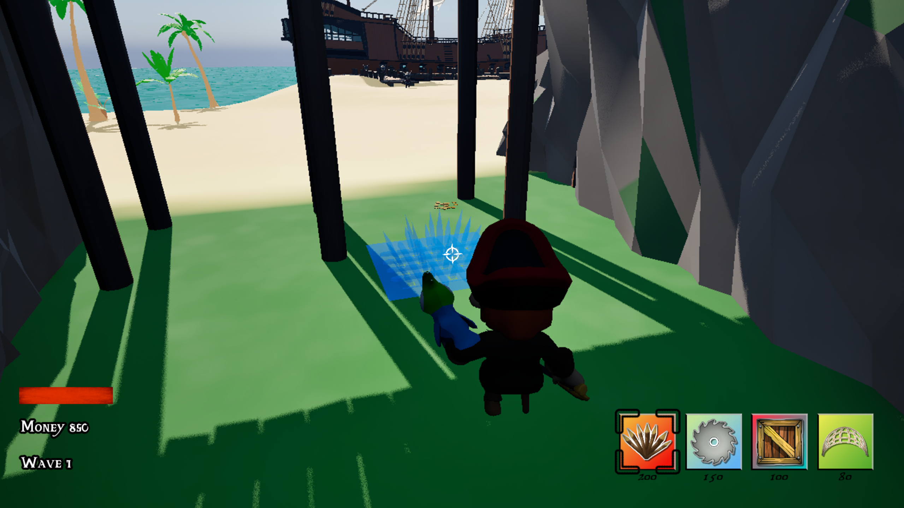
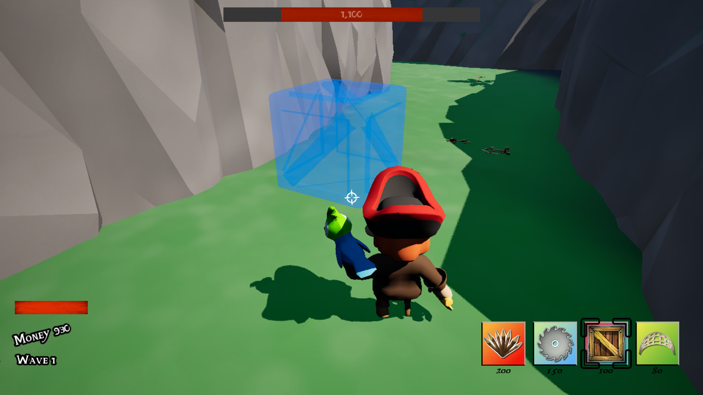
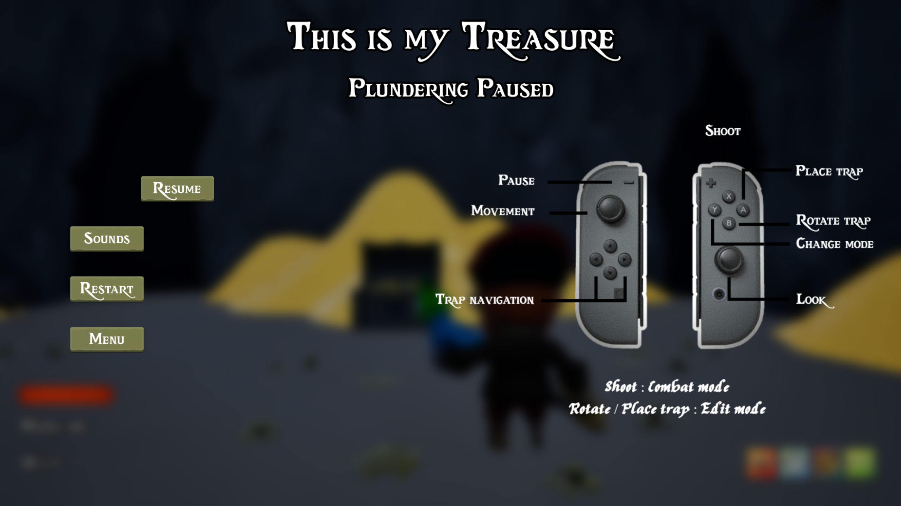
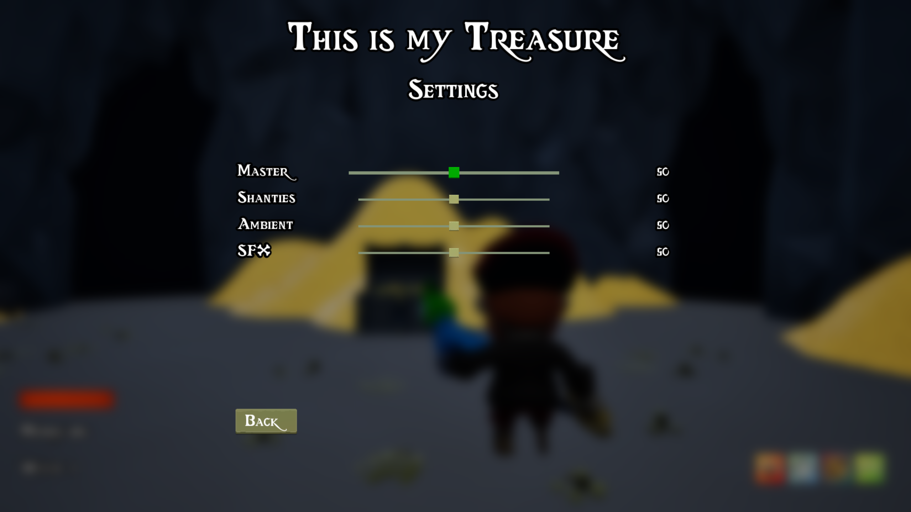
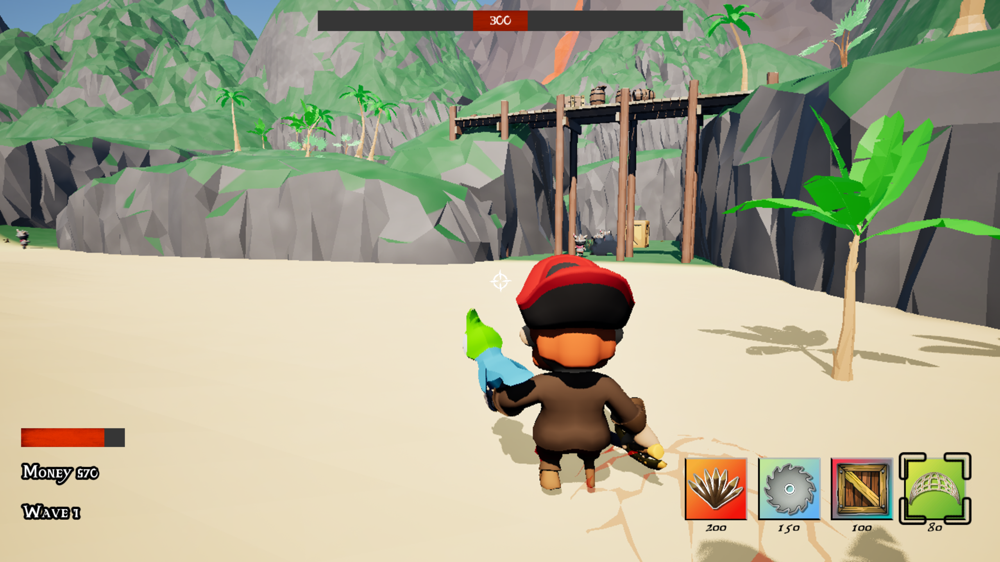
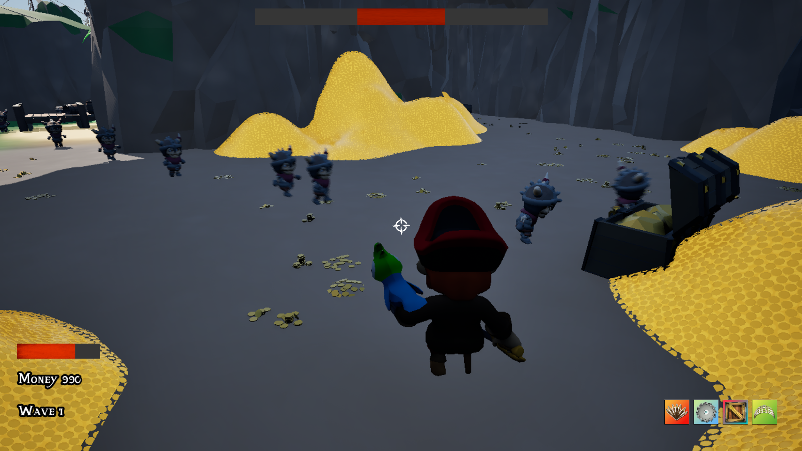
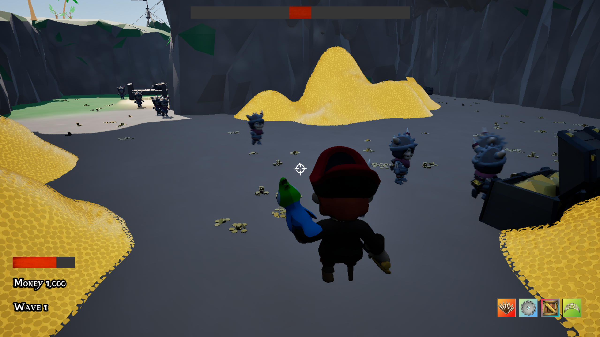
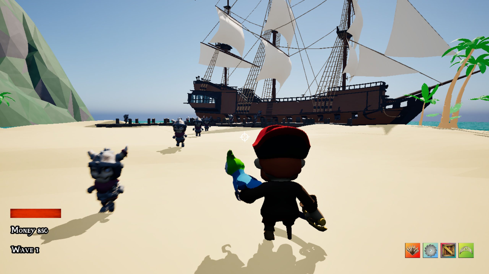
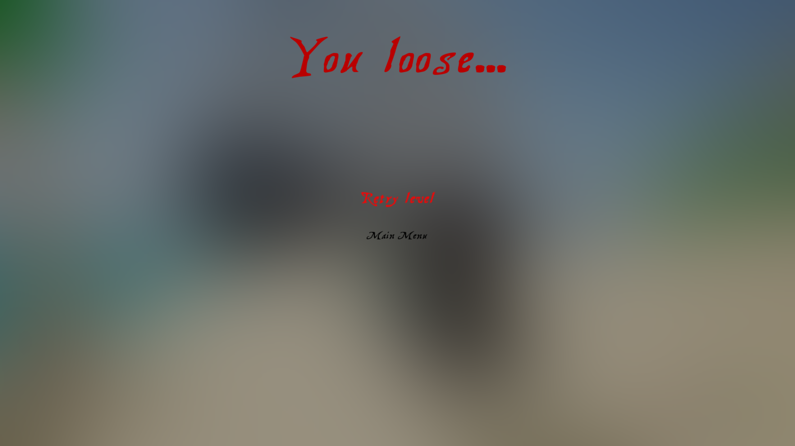

## Authors:
- FONTVERNE Antoine
- GUEDU Arthur
- LINDNER Marc